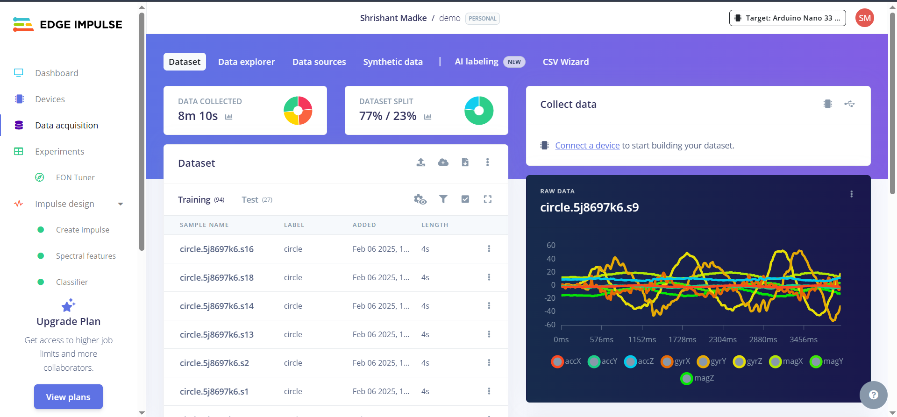
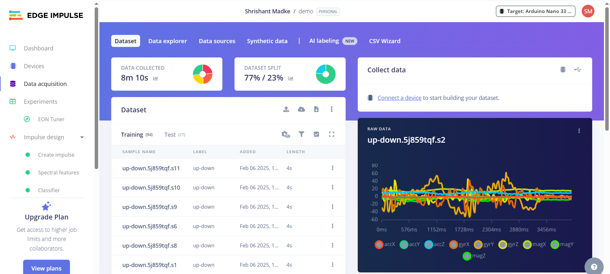
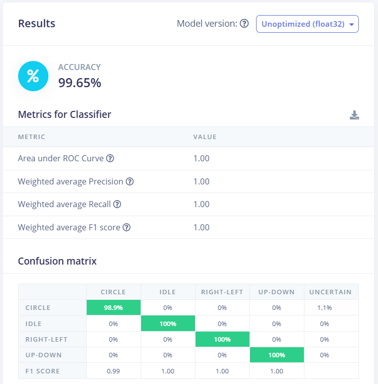

# Smart Home Automation using Gesture Detection

A gesture-based home automation system that controls appliances such as **lights and motors** through hand movements. An accelerometer captures the motion, a machine-learning model trained with **Edge Impulse** classifies the gesture, and commands are sent over **Bluetooth** for contactless operation.

Built with **ESP32**, **Raspberry Pi** and **Edge Impulse** as part of my work on Internet of Things and Edge Computing. The project introduced me to integrating machine-learning models with embedded systems to build practical automation solutions.

---

## Features

- Contactless control of appliances (lights, motors) using hand gestures
- Motion sensing with an accelerometer
- On-device (edge) inference with a quantized TinyML model — no cloud needed at runtime
- Bluetooth communication between the gesture node and the appliance controller
- Four recognised classes: `circle`, `idle`, `right-left`, `up-down`

## Tech Stack

| Area | Tools |
|---|---|
| Machine learning | Edge Impulse (spectral features + neural network classifier) |
| Microcontrollers / SBC | ESP32, Raspberry Pi, Arduino Nano 33 BLE Sense (Edge Impulse target) |
| Sensor | Accelerometer (IMU) |
| Communication | Bluetooth |
| Language | C++ (Arduino), Python |

## How It Works

```
Hand gesture ─► Accelerometer ─► Edge Impulse model ─► Gesture label ─► Bluetooth ─► Appliance control
                 (3 axes, 100 Hz)   (on-device inference)   (circle / idle /          (light / motor)
                                                             right-left / up-down)
```

1. **Data collection** – Motion data was recorded for each gesture and labelled in Edge Impulse.
2. **Impulse design** – Raw accelerometer data → *Spectral features* DSP block → neural-network classifier.
3. **Deployment** – The trained model was exported as an Arduino library (`demo_inferencing`) and run on the embedded device.
4. **Actuation** – The recognised gesture is sent over Bluetooth to trigger the matching appliance action.

## Dataset

Screenshots from the Edge Impulse project (`demo`):

- **Total data collected:** 8 min 10 s
- **Train / test split:** 77% / 23% (94 training samples, 27 test samples)
- **Sample length:** 4 s each
- **Classes:** `circle`, `idle`, `right-left`, `up-down`
- **Recorded sensors:** accelerometer, gyroscope and magnetometer (accX/Y/Z, gyrX/Y/Z, magX/Y/Z)

| Circle gesture sample | Up-down gesture sample |
|---|---|
|  |  |

## Model

Details taken from the exported model (`edge-impulse-model/demo_inferencing/src/model-parameters/model_metadata.h`):

| Parameter | Value |
|---|---|
| Edge Impulse project | `demo` (ID 618817), deploy version 12 |
| Sensor | Accelerometer, 3 axes |
| Sampling frequency | 100 Hz (10 ms interval) |
| Window size | 200 samples (2 s) |
| Output classes | 4 (`circle`, `idle`, `right-left`, `up-down`) |
| Model type | Quantized (int8) TensorFlow Lite, compiled for embedded use |
| Target | Arduino Nano 33 BLE |

### Results

Classifier performance (unoptimized float32 model):

- **Accuracy:** 99.65%
- **Area under ROC curve / Weighted precision / recall / F1:** 1.00

| Class | Correct |
|---|---|
| circle | 98.9% (1.1% uncertain) |
| idle | 100% |
| right-left | 100% |
| up-down | 100% |



## Repository Structure

```
Smart-Home-Automation-Gesture-Detection/
├── README.md
├── images/                          # Dataset and result screenshots
│   ├── dataset-circle-gesture.png
│   ├── dataset-up-down-gesture.png
│   └── model-results-confusion-matrix.png
└── edge-impulse-model/
    └── demo_inferencing/            # Edge Impulse Arduino library (v1.0.12)
        ├── library.properties
        ├── src/                     # Model, DSP code and Edge Impulse SDK
        └── examples/                # Ready-made sketches (accelerometer, etc.)
```

## Getting Started

### 1. Install the model library in Arduino IDE

**Option A – Zip install:** zip the `edge-impulse-model/demo_inferencing` folder, then in Arduino IDE go to
`Sketch ▸ Include Library ▸ Add .ZIP Library…` and select it.

**Option B – Manual:** copy the `demo_inferencing` folder into your Arduino `libraries/` directory and restart the IDE.

### 2. Install dependencies

Install **Arduino_LSM9DS1** from the Library Manager (needed for the Nano 33 BLE Sense accelerometer).

### 3. Run an example

Open `File ▸ Examples ▸ demo_inferencing` and choose the sketch for your board, for example:

- Arduino Nano 33 BLE Sense: `nano_ble33_sense_accelerometer` (or `..._continuous`)
- ESP32: see the `esp32` examples

Open the Serial Monitor at **115200 baud**, perform a gesture, and the predicted label and confidence will be printed.

### 4. Connect to your appliances

Map each recognised gesture to an action in your sketch and send it over Bluetooth to the controller driving your appliances. An example mapping (adjust to match your setup):

| Gesture | Example action |
|---|---|
| `circle` | Toggle light |
| `right-left` | Motor on / off |
| `up-down` | Change speed / brightness |
| `idle` | No action |

## What I Learned

- Collecting, labelling and balancing sensor data for gesture classification
- Designing an impulse in Edge Impulse (spectral features + neural network)
- Deploying quantized models to resource-constrained embedded devices
- Combining ML inference with Bluetooth communication for real-world IoT automation

## Author

**Shrishant Madhav Madke**
GitHub: [@Shree8856](https://github.com/Shree8856)

## License

The Edge Impulse SDK inside `edge-impulse-model/demo_inferencing/src/edge-impulse-sdk` is distributed under its own license (see the `LICENSE` file in that folder). Add a license for the rest of the project as you prefer.
